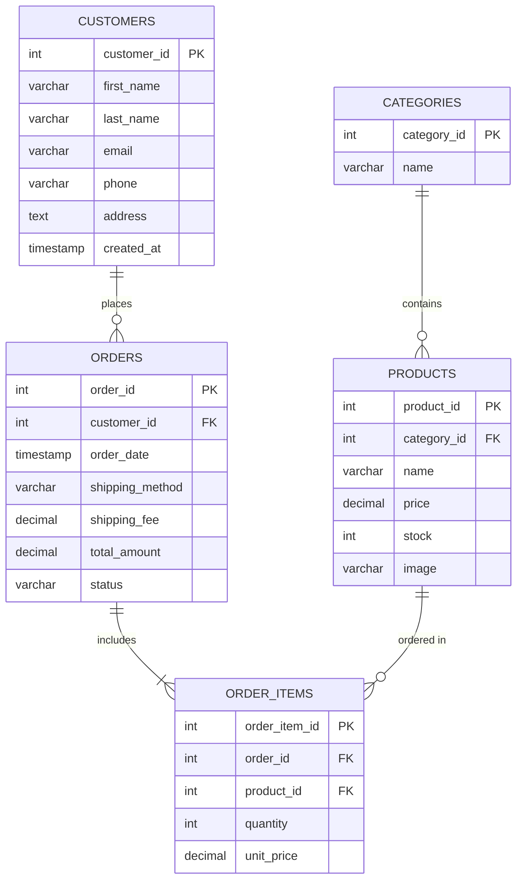

# TechStore Full-Stack E-Commerce Project

A complete, modern full-stack e-commerce project built in 6 structured steps:
- **Frontend**: React 18, Vite, React Router, Tailwind CSS, Lucide icons, Context API (`src/`).
- **Backend**: Laravel 12 API, Eloquent ORM, FormRequest validation, API Resources (`ecommerce-api/`).
- **Database**: MySQL database named `kh_qr`.

---

## 📑 Table of Contents
1. [Project Overview & Architecture](#-project-overview--architecture)
2. [Step 1: React UI + Database ERD](#-step-1-react-ui--erd-5-tables)
3. [Step 2: Git & GitHub Workflow](#-step-2-push-ui-to-github)
4. [Step 3: Laravel API (Products & Categories)](#-step-3-laravel-api-product-and-category)
5. [Step 4: Database Seeders](#-step-4-database-seeders)
6. [Step 5: Product API Documentation & Testing](#-step-5-product-api-testing)
7. [Step 6: Frontend to API Connection](#-step-6-connect-api-to-frontend)
8. [Running Both Servers](#-how-to-run-both-servers)

---

## 🏗 Project Overview & Architecture

```text
Connect_KH_qr/
├── .env.example                       # Frontend environment variables template
├── index.html                         # React application entry HTML
├── package.json                       # React dependencies & scripts
├── vite.config.js                     # Vite build configuration (base path & plugins)
├── tailwind.config.js                 # Tailwind CSS design system configuration
├── src/
│   ├── data/
│   │   └── products.js                # Initial hardcoded store catalog (Step 1)
│   ├── services/
│   │   └── api.js                     # Axios client & API endpoints (Step 6)
│   ├── context/
│   │   └── ShopContext.jsx            # Cart & Order state with localStorage
│   ├── components/
│   │   ├── Navbar.jsx                 # Header with live item count badge
│   │   ├── Footer.jsx                 # Brand trust props and links
│   │   ├── ProductCard.jsx            # Product card with Add-to-Cart logic
│   │   ├── CartItem.jsx               # Quantity modifier (- / +) and trash button
│   │   └── OrderSummary.jsx           # Order summary with shipping & discounts
│   └── pages/
│       ├── ProductListPage.jsx        # Catalog with search, category pills & API loading
│       ├── CartPage.jsx               # Cart table and sticky Order Summary
│       ├── CheckoutPage.jsx           # Customer form, validation & shipping radio
│       └── OrderConfirmationPage.jsx  # Order placed success screen (ORD-0001)
│
└── ecommerce-api/                     # Laravel 12 Backend API
    ├── .env.example                   # Laravel environment variables template
    ├── config/cors.php                # CORS configuration for http://localhost:5173
    ├── app/
    │   ├── Models/
    │   │   ├── Category.php           # Eloquent Category (hasMany Product)
    │   │   └── Product.php            # Eloquent Product (belongsTo Category)
    │   ├── Http/
    │   │   ├── Controllers/
    │   │   │   ├── CategoryController.php # Category CRUD
    │   │   │   └── ProductController.php  # Product CRUD, filters, search, pagination
    │   │   ├── Requests/
    │   │   │   ├── CategoryRequest.php    # FormRequest validation for Category
    │   │   │   └── ProductRequest.php     # FormRequest validation for Product
    │   │   └── Resources/
    │   │       ├── CategoryResource.php   # JSON API Resource for Category
    │   │       └── ProductResource.php    # JSON API Resource for Product
    ├── database/
    │   ├── migrations/
    │   │   ├── 2026_01_01_000001_create_categories_table.php
    │   │   └── 2026_01_01_000002_create_products_table.php
    │   └── seeders/
    │       ├── CategorySeeder.php     # Computers, Accessories, Displays
    │       ├── ProductSeeder.php      # Laptop, Mouse, Keyboard, Monitor
    │       └── DatabaseSeeder.php     # Master seeder registration
    └── routes/
        └── api.php                    # RESTful apiResource routes
```

---

## 📊 STEP 1: React UI + ERD (5 Tables)

### 1A. React UI Specification
- **Product List (`/`)**: Displays flagship products with "Add to Cart" button (increments quantity if already in cart). Sticky header displays a cart icon with live item-count badge. Includes live search bar and category filter pills.
- **Cart Page (`/cart`)**: Lists each item with thumbnail image, name, unit price, quantity modifier (`-` / `+`, minimum 1), and line total. Trash button removes items. Sticky Order Summary displays Subtotal, Delivery, Discount, and Grand Total. Includes an empty-cart state with a "Continue Shopping" link and a disabled checkout button when cart is empty.
- **Checkout Page (`/checkout`)**: Customer form fields (First Name, Last Name, Email, Phone Number, Street Address, City, State, Zip). Field validations enforce non-empty fields, valid email format regex (`^[^\s@]+@[^\s@]+\.[^\s@]+$`), and numeric phone numbers. Form submission is blocked until validation passes. Shipping radio selection recalculates Grand Total live (**Free Shipping $0** vs **Express Shipping $9**).
- **Order Confirmation Page (`/order-confirmation`)**: Displays "Order Placed Successfully!", auto-incrementing Order ID in `ORD-0001` format, Customer Name, Order Date, Ordered Products table, Grand Total, and "Pending" status. Automatically empties the cart upon placement and redirects to `/` if accessed without an active order.

### 1B. Database Design (Mermaid ERD)



---

## 🐙 STEP 2: Push UI to GitHub

### Initial Repository Setup & Push
```powershell
# 1. Ensure .gitignore covers build artifacts and secrets
# (node_modules, dist, .env, ecommerce-api/vendor, etc.)

# 2. Initialize git repository
git init

# 3. Stage all source files and commit
git add .
git commit -m "Initial commit: React shopping UI"

# 4. Set branch to main and add GitHub remote
git branch -M main
git remote add origin https://github.com/Phanet9531/KH_QR.git

# 5. Push to GitHub
git push -u origin main
```

### Feature Branch & Pull Request (PR) Workflow
For subsequent features (e.g. adding Laravel backend or API integration):
```powershell
# 1. Create and switch to a feature branch
git checkout -b feature/laravel-api-integration

# 2. Make your edits and commit
git add .
git commit -m "feat: Add Laravel product API with MySQL seeders"

# 3. Push feature branch to GitHub
git push -u origin feature/laravel-api-integration

# 4. Open Pull Request on GitHub
# Navigate to https://github.com/Phanet9531/KH_QR/pull/new/feature/laravel-api-integration
# Review diff, assign reviewers, and merge into 'main'
```

---

## ⚡ STEP 3: Laravel API (Product and Category)

### 1. Create Project & Configure Database
```powershell
composer create-project laravel/laravel ecommerce-api
cd ecommerce-api
```

In `ecommerce-api/.env`, configure MySQL database `kh_qr`:
```env
DB_CONNECTION=mysql
DB_HOST=127.0.0.1
DB_PORT=3306
DB_DATABASE=kh_qr
DB_USERNAME=root
DB_PASSWORD=
```

### 2. Enable CORS
File: `ecommerce-api/config/cors.php`
```php
'paths' => ['api/*', 'sanctum/csrf-cookie'],
'allowed_origins' => ['http://localhost:5173', 'http://127.0.0.1:5173'],
'allowed_methods' => ['*'],
'allowed_headers' => ['*'],
'supports_credentials' => true,
```

### 3. Routes
File: `ecommerce-api/routes/api.php`
```php
use App\Http\Controllers\CategoryController;
use App\Http\Controllers\ProductController;
use Illuminate\Support\Facades\Route;

Route::apiResource('categories', CategoryController::class);
Route::apiResource('products', ProductController::class);
```

---

## 🌱 STEP 4: Database Seeders

### Run Migration and Seeders
Ensure MySQL service is started (e.g. via XAMPP), then run:
```powershell
cd ecommerce-api
php artisan migrate:fresh --seed
```

### Seeded Catalog Data:
- **Categories**:
  - `1`: Computers
  - `2`: Accessories
  - `3`: Displays
- **Products**:
  - `1`: Laptop — **$650.00** (Computers, Stock: 15)
  - `2`: Mouse — **$15.00** (Accessories, Stock: 50)
  - `3`: Keyboard — **$25.00** (Accessories, Stock: 35)
  - `4`: Monitor — **$120.00** (Displays, Stock: 20)

---

## 🔍 STEP 5: Product API Testing

### Endpoints Overview

| Method | Endpoint | Description |
| :--- | :--- | :--- |
| `GET` | `/api/categories` | Retrieve all categories with `products_count` |
| `GET` | `/api/categories/{id}` | Retrieve single category with its products |
| `POST` | `/api/categories` | Create category (`name` required, unique) |
| `PUT` | `/api/categories/{id}` | Update category |
| `DELETE` | `/api/categories/{id}` | Delete category |
| `GET` | `/api/products` | Retrieve products with `category` eager loaded, search, filter, pagination |
| `GET` | `/api/products/{id}` | Retrieve single product with its category |
| `POST` | `/api/products` | Create product (validated with `ProductRequest`) |
| `PUT` | `/api/products/{id}` | Update product |
| `DELETE` | `/api/products/{id}` | Delete product |

### Example 1: Get Products with Category Eager Loading
**Request:**
```bash
curl -X GET http://localhost:8000/api/products -H "Accept: application/json"
```

**Response (`200 OK`):**
```json
{
  "status": "success",
  "message": "Products retrieved successfully",
  "data": [
    {
      "id": 1,
      "name": "Laptop",
      "price": 650,
      "stock": 15,
      "image": "https://images.unsplash.com/photo-1496181133206-80ce9b88a853?auto=format&fit=crop&w=600&q=80",
      "category_id": 1,
      "category": {
        "id": 1,
        "name": "Computers"
      }
    },
    {
      "id": 2,
      "name": "Mouse",
      "price": 15,
      "stock": 50,
      "image": "https://images.unsplash.com/photo-1527864550417-7fd91fc51a46?auto=format&fit=crop&w=600&q=80",
      "category_id": 2,
      "category": {
        "id": 2,
        "name": "Accessories"
      }
    }
  ],
  "meta": {
    "current_page": 1,
    "last_page": 1,
    "per_page": 10,
    "total": 4
  }
}
```

### Example 2: Filter by Category & Search
```bash
# Filter products belonging to Accessories (id: 2)
curl -X GET "http://localhost:8000/api/products?category_id=2"

# Search for "keyboard"
curl -X GET "http://localhost:8000/api/products?search=keyboard"
```

### Example 3: Validation Error Format
```bash
curl -X POST http://localhost:8000/api/products \
  -H "Content-Type: application/json" \
  -H "Accept: application/json" \
  -d '{"name": "Webcam"}'
```
**Response (`422 Unprocessable Content`):**
```json
{
  "message": "Please select a valid category. (and 1 more error)",
  "errors": {
    "category_id": ["Please select a valid category."],
    "price": ["Product price is required."]
  }
}
```

---

## 🔌 STEP 6: Connect API to Frontend

### 1. Frontend Environment Setup
Create `.env` in the root folder:
```env
VITE_API_URL=http://localhost:8000/api
```

### 2. API Service Layer
File: `src/services/api.js`
- Created using `axios` with base URL configured from `import.meta.env.VITE_API_URL`.
- Provides `getProducts(params)`, `getProductById(id)`, and `getCategories()`.
- Incorporates graceful offline fallback: if backend is unreachable, the store safely falls back to local data so the UI remains fully functional.

### 3. Integrated Catalog UI
File: `src/pages/ProductListPage.jsx`
- Fetches real categories from `/api/categories` to build interactive category filter pills.
- Fetches live products from `/api/products` with loading spinners and error alerts.
- Live search query input with automatic debouncing.
- Seamlessly feeds the API product ID and price into the persistent Context API Cart, Checkout, and Confirmation receipt.

---

## 🚀 How to Run Both Servers

### Terminal 1: Start Laravel Backend Server
```powershell
cd ecommerce-api
php artisan serve --port=8000
```
Backend API will be running at `http://localhost:8000/api`.

### Terminal 2: Start React Frontend Development Server
```powershell
npm install
npm run dev
```
Frontend will be running at `http://localhost:5173`.

### 🛡 Troubleshooting CORS:
If you see a `CORS error` in your browser console:
1. Verify `config/cors.php` in `ecommerce-api` includes `'allowed_origins' => ['http://localhost:5173', 'http://127.0.0.1:5173']`.
2. Clear the Laravel configuration cache:
   ```powershell
   cd ecommerce-api
   php artisan config:clear
   ```
3. Refresh `http://localhost:5173`.
