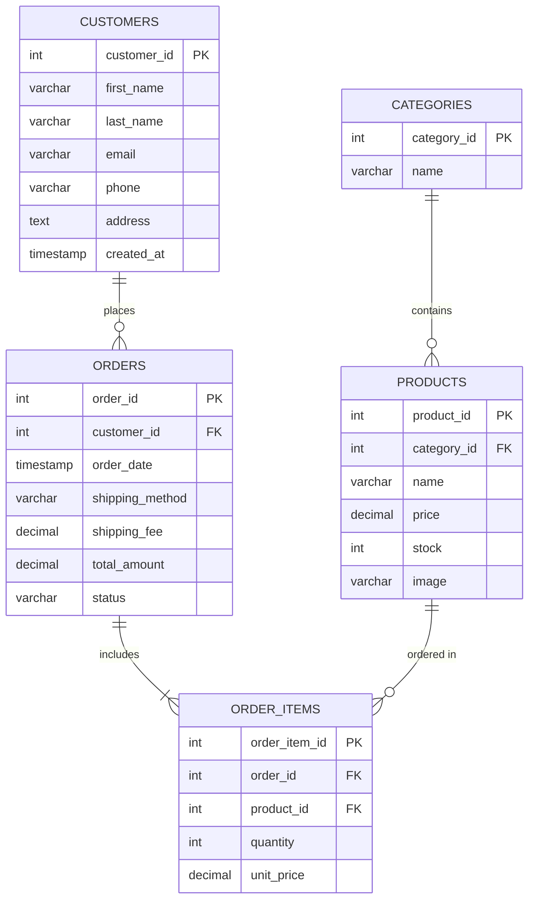

# TechStore - React E-Commerce Application

A clean, responsive e-commerce web application built with **React JS**, **Vite**, **React Router v6**, and **Tailwind CSS**. State management is handled with **React Context API**, with seamless **localStorage** persistence for cart items and auto-incrementing orders.

---

## 🚀 Features

- **Part 1: Product Catalog (`/`)**
  - Displays 4 hardcoded flagship tech products (Laptop $650, Mouse $15, Keyboard $25, Monitor $120).
  - Add to Cart button increases item count if already present in cart.
  - Sticky header with live cart count badge.
- **Part 2: Shopping Cart (`/cart`)**
  - View cart with product image, unit price, quantity modifier (`-` and `+` with a minimum of 1), and line total.
  - Remove items with a trash button.
  - Sticky Order Summary panel (Subtotal, Delivery, Discount, Grand Total).
  - Empty cart state with "Continue Shopping" link.
  - "Proceed to Checkout" button disabled when cart is empty.
- **Part 3: Checkout Page (`/checkout`)**
  - Customer information form with required validation and inline error messages (Email format check, numeric phone check).
  - Shipping method selector: **Free Shipping ($0, 7-20 days)** vs **Express Shipping ($9, 1-3 days)**.
  - Live recalculation of Grand Total based on selected shipping option.
  - Form submit is blocked until all required fields are valid.
- **Part 4: Order Confirmation Page (`/order-confirmation`)**
  - Order placed successfully screen.
  - Auto-incrementing Order ID in `ORD-0001` format.
  - Displays customer name, order date, order items (name, qty, price), total amount, and "Pending" status.
  - Automatically redirects to `/` if accessed without an order.
  - Printable invoice action and continue shopping button.

---

## 🛠️ Getting Started

### Prerequisites
- Node.js (v18+ recommended)
- npm or yarn

### Installation & Run

```bash
# 1. Install dependencies
npm install

# 2. Run the development server
npm run dev
```

The app will be available at `http://localhost:5173`.

To build for production:
```bash
npm run build
npm run preview
```

---

## 📂 Project Structure

```text
Connect_KH_qr/
├── index.html
├── package.json
├── vite.config.js
├── tailwind.config.js
├── postcss.config.js
├── README.md
└── src/
    ├── main.jsx                 # Application entry point
    ├── App.jsx                  # Main router setup
    ├── index.css                # Tailwind CSS imports & base styles
    ├── data/
    │   └── products.js          # Hardcoded product catalog
    ├── context/
    │   └── ShopContext.jsx      # Context API for cart, order & persistence
    ├── components/
    │   ├── Navbar.jsx           # Top navigation with live cart badge
    │   ├── Footer.jsx           # Trust badges & footer information
    │   ├── ProductCard.jsx      # Product card with Add-to-Cart logic
    │   ├── CartItem.jsx         # Cart row with +/- quantity and remove
    │   └── OrderSummary.jsx     # Sticky order summary breakdown
    └── pages/
        ├── ProductListPage.jsx  # Hero section & 4-card catalog
        ├── CartPage.jsx         # Cart table & summary layout
        ├── CheckoutPage.jsx     # Checkout form & shipping radio selection
        └── OrderConfirmationPage.jsx # Success screen & invoice receipt
```

---

## 🗄️ PART 5: Database Design (ERD)

### Mermaid Entity-Relationship Diagram



### Table Descriptions & Data Dictionary

#### 1. `CUSTOMERS`
Stores buyer profile, communication contact, and default billing/shipping address.
- `customer_id` (**PK**, `INT`, Auto Increment): Unique customer identifier.
- `first_name` (`VARCHAR(100)`, NOT NULL): Customer first name.
- `last_name` (`VARCHAR(100)`, NOT NULL): Customer last name.
- `email` (`VARCHAR(255)`, NOT NULL, UNIQUE): Customer email address for order notifications.
- `phone` (`VARCHAR(25)`, NOT NULL): Customer phone number for delivery contact.
- `address` (`TEXT`, NOT NULL): Street address, city, state, postal code.
- `created_at` (`TIMESTAMP`, DEFAULT CURRENT_TIMESTAMP): Account registration timestamp.

#### 2. `CATEGORIES`
Defines grouping for store merchandise.
- `category_id` (**PK**, `INT`, Auto Increment): Unique category identifier.
- `name` (`VARCHAR(100)`, NOT NULL, UNIQUE): Category display name (e.g. Computers, Accessories, Peripherals, Displays).

#### 3. `PRODUCTS`
Catalog of merchandise available for purchase.
- `product_id` (**PK**, `INT`, Auto Increment): Unique product identifier.
- `category_id` (**FK**, `INT`, References `CATEGORIES(category_id)`): Foreign key linking product to its category.
- `name` (`VARCHAR(255)`, NOT NULL): Product title.
- `price` (`DECIMAL(10,2)`, NOT NULL): Current selling unit price in USD.
- `stock` (`INT`, NOT NULL, DEFAULT 0): Available stock quantity.
- `image` (`VARCHAR(500)`): URL path or asset key to product thumbnail image.

#### 4. `ORDERS`
Header table recording placed customer orders.
- `order_id` (**PK**, `INT`, Auto Increment): Unique order identifier (rendered as `ORD-XXXX`).
- `customer_id` (**FK**, `INT`, References `CUSTOMERS(customer_id)`): Foreign key to the purchasing customer.
- `order_date` (`TIMESTAMP`, DEFAULT CURRENT_TIMESTAMP): Timestamp when checkout was completed.
- `shipping_method` (`VARCHAR(50)`, NOT NULL): Selected delivery method ("Free Shipping" or "Express Shipping").
- `shipping_fee` (`DECIMAL(10,2)`, NOT NULL): Cost of shipping ($0.00 or $9.00).
- `total_amount` (`DECIMAL(10,2)`, NOT NULL): Final grand total (`Subtotal + shipping_fee - discounts`).
- `status` (`VARCHAR(30)`, NOT NULL, DEFAULT 'Pending'): Order fulfillment status (`Pending`, `Processing`, `Shipped`, `Delivered`, `Cancelled`).

#### 5. `ORDER_ITEMS`
Line item junction table capturing the exact products, historical unit prices, and quantities per order.
- `order_item_id` (**PK**, `INT`, Auto Increment): Unique order item row identifier.
- `order_id` (**FK**, `INT`, References `ORDERS(order_id)` ON DELETE CASCADE): Foreign key linking line item to the parent order.
- `product_id` (**FK**, `INT`, References `PRODUCTS(product_id)`): Foreign key linking to the purchased product.
- `quantity` (`INT`, NOT NULL, CHECK `quantity > 0`): Number of units purchased.
- `unit_price` (`DECIMAL(10,2)`, NOT NULL): Historical price at time of order placement.

---

### Entity Relationships
- **Customers 1-N Orders (`CUSTOMERS ||--o{ ORDERS`)**: One customer can place zero or many orders over time. Each order belongs to exactly one customer.
- **Categories 1-N Products (`CATEGORIES ||--o{ PRODUCTS`)**: One category groups multiple products. Each product belongs to one primary category.
- **Orders 1-N Order_Items (`ORDERS ||--|{ ORDER_ITEMS`)**: One order consists of one or more order line items. If an order is deleted, its items are cascaded.
- **Products 1-N Order_Items (`PRODUCTS ||--o{ ORDER_ITEMS`)**: A product can appear across multiple order line items in different customer orders.
# KH_QR

# KH_QR

# KH_QR

